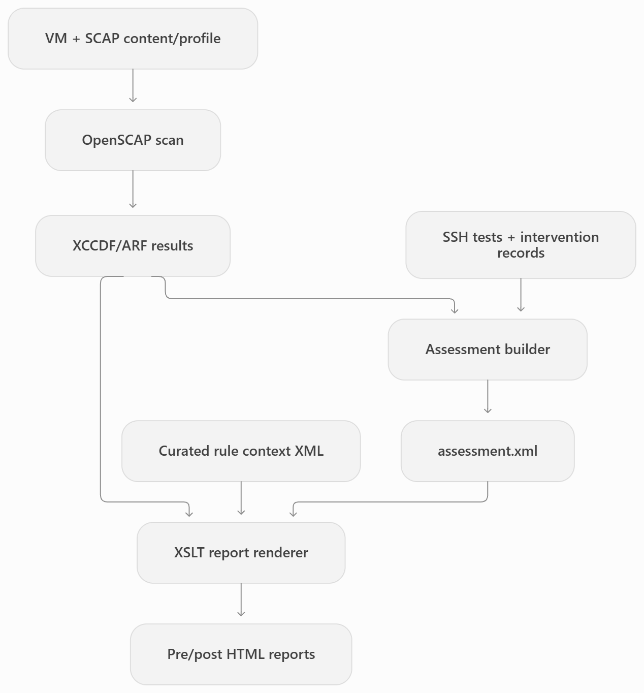

\newpage

```abstract

```

# Introduction

One of the leading problems in the current Information Systems Industry is
effective security hardening of servers and the systems they run. One of
the most important aspects of the solution is the scanning, detection
and remediation of security vulnerabilities. The Security Content Automation
Protocol (SCAP), developed by the National Institute of Standards and
Technology (NIST), was created to facilitate this solution, and is an
attempt to provide a standard that could be used by different products
to automate security compliance scanning and hardening.

OpenSCAP assesses a system's security compliance against established
baselines and scans for known software vulnerabilities. It provides
administrators with detailed pass/fail reports, vulnerability lists, and
automated remediation scripts in formats such as bash scripts or
Ansible yaml playbooks. XCCDF is used for checking system settings such
as password policies, file permissions, firewall rules, and kernel
parameters—against standardized security profiles like CIS Benchmarks,
DISA STIG, PCI-DSS, or HIPAA. OVAL is used to inspect installed packages
and software versions against vulnerability databases like Red Hat
Security Advisories or CVEs to identify security flaws.

OpenSCAP evaluates security configuration using SCAP content and can
produce reports from the resulting assessments. ComplianceAsCode
supplies machine-readable security policies, including content
implementing CIS guidance. These capabilities provide the foundation
for this project; the proposed enrichment supplements the existing
report rather than replacing its checks or remediation information.

One of the weaknesses of the current implementation of OpenSCAP is that
the reports generated can be difficult to read and use by the user. The
current reports provide information about identified deviations from
security baselines, but do not provide additional relevant context
around why the rules were considered compliant/noncompliant (what
preconditions led to this), what effect the proposed system change would
have on a system and it's services, whether an improvement leads to a
meaningful reduction in attack surface, and leaves the decision making
to the user who may need to perform additional research on their own.

## Proposed Solution

The proposed solution provided in this project is a system for an
"Enhanced Report" generation added to OpenSCAP that separates reusable
knowledge about a control from observations about a specific host and
from the conclusions drawn using those observations. Its intended output
is a report in which each substantive assessment can be traced to a
mapping revision, a selected scan result, and supporting evidence. The
initial implementation appends the curated context to native OpenSCAP
HTML. The planned extension will regenerate host-specific
interpretations after a new scan and evidence refresh. The report
assessment is meant to be "dynamic", or that the report's interpretation
can change when given different before-and-after evidence. To put more
simply; the central Idea is to preserve the scanner's result, then add
carefully linked evidence that helps an administrator interpret what
changed and decide whether it fits their operational needs.

The project does not assume that existing tools lack contextual
explanations, nor does it claim that this approach is novel across
literature. A comparative related-work review remains necessary before
making that claim. Improved administrator comprehension is a motivation,
not a measured outcome of the present laboratory study.

## Contributions

The primary contributions of this project include an assessment method,
a prototype implementation of the solution, and a demonstration of the
prototype in a lab environment. The evidence-based assessment method
separates curated explanations, observations from a particular scan and
test run, and the conclusions drawn from them. This helps prevent a
failed check from being treated as proof of a successful attack, or a
passing check as proof that every access path is safe. The prototype
adds context to OpenSCAP reports. The assessment builder and XSLT
renderer preserve OpenSCAP's original result while adding specific
evidence, related-rule context, and a qualified interpretation. Part of
the contribution is it's handling of conflicting, missing or mismatched
evidence: the report can leave an assessment "indeterminate" instead of
presenting unsupported certainty. Lastly, the SSH experiment tested
direct-root login, showed "success" before the change and was denied
afterward, and the tested named login and sudo workflow still worked.
The earlier permissions regression and correction show why related
controls can matter to the interpretation as well.

# Technical Background

## OpenSCAP

OpenSCAP is an open source implementation of the National Institute of
Standards and Technology (NIST)'s Security Content Automation Protocol
(SCAP), developed by Red Hat. The OpenSCAP ecosystem provides multiple
tools that allow administrators to assess, measure, and enforce security
controls. It is a software for evaluating security configuration and
vulnerability content expressed through SCAP specifications. SCAP is a
family of specifications; XCCDF provides a structured format for
checklists, benchmarks, rules, and assessment results [1]. OpenSCAP can
evaluate a SCAP datastream against a chosen profile and produce
machine-readable results and an HTML report. Depending on content,
checks may use OVAL or another supported check engine [2]. OpenSCAP can
generate remediation scripts from the resulting XCCDF content, in the
form of a bash script or an Ansible yaml playbook.

### XCCDF and it's use by OpenSCAP

XCCDF is "A structured collection of security configuration rules for
some set of target systems." It is an XML format for expressing
security checklists and benchmarks. It is designed to support generating
documentation for tailoring based on organization and situation and automate
compliance testing through scoring. The specification defines a data
model and format for storing results of checklists and other guides, and
therefore facilitates a more common use of better security practices [3].

example 1.1: an XCCDF result records a rule identifier and its result. The
real document has more srtucture, this shows the part that will be
transformed:
```xslt
<xccdf:TestResult
    xmlns:xccdf="http://checklists.nist.gov/xccdf/1.2">

  <xccdf:rule-result
      idref="xccdf_org.ssgproject.content_rule_sshd_disable_root_login">
    <xccdf:result>fail</xccdf:result>
  </xccdf:rule-result>

</xccdf:TestResult>
```

XCCDF defines the structure for benchmarks and their results. OpenSCAP
evaluates the selected content and can produce XCCDF results and an HTML
report.

A benchmark can contain rules and profiles, and XCCDF also defines how
assessment results are represented. A profile selects which rules are in
scope for a particular assessment. XCCDF describes and organizes this
assessment, but does not, by itself, inspect the server.

A simplified relationship looks like the following:
    - Benchmark: the collection of guidance and checks.
    - Profile: a specific requirement, suck as disabling direct SSH root
      login.
    - Rule: a specific requirement, such as disabling direct SSH root
      login.
    - Check: the test used to evaluate that requirement.
    - Test Result: the recorded outcome for each rule, such as `pass` or
      `fail`

Rule results have specific meaning. In the OpenSCAP manual, a "pass"
means the target satisfied the rule's conditions, and "fail" means it
did not. `notselected` means the rule was outside the chosen profile,
while `notapplicable` concerns whether the content applies to the target, so
these should not be treated as interchangeable. Scan results are narrower than
a security verdict. From the result definitions, it follows that a failed check
establishes nonconformance with a rule's conditions, but by itself, it does not
prove an attacker can exploit the system. Likewise, a passing check does not
prove the entire system is secure [2].

OpenSCAP is the evaluator. For example, in the lab, it receives the
Ubuntu SCAP content and the CIS Level 1 Server profile, evaluates the
selected checks against the VM, and records results. The content is
packaged as a SCAP source data stream, which may bundle the XCCDF
benchmark with check definitions and platform applicability information.
OpenSCAP can save "machine-readable" results and generate an HTML report
from those results [2].

## Overview of XSLT

XSLT is a language for transforming XML documents, and the technology
used for OpenSCAP's XCCDF stylesheets. A stylesheet contains templates
that match parts of an input document. "XPath" expressions select
elements or values from the XML and the templates use them to build an
output document, for example, the resulting HTML report [4].


```xslt
<xsl:stylesheet version="1.0"
    xmlns:xsl="http://www.w3.org/1999/XSL/Transform"
    xmlns:x="http://checklists.nist.gov/xccdf/1.2"
    exclude-result-prefixes="x">

  <xsl:output method="html" encoding="UTF-8" indent="yes"/>

  <!-- Starting template: process the document as a whole. -->
  <xsl:template match="/">
    <html>
      <head>
        <title>Assessment results</title>
      </head>
      <body>
        <h1>Assessment results</h1>

        <!-- Find each XCCDF rule result and process it with a matching template. -->
        <xsl:apply-templates select="//x:rule-result"/>
      </body>
    </html>
  </xsl:template>

  <!-- This template runs once for each x:rule-result element. -->
  <xsl:template match="x:rule-result">
    <div class="rule">
      <h2>
        <xsl:value-of select="@idref"/>
      </h2>

      <p>
        Result:
        <xsl:value-of select="x:result"/>
      </p>

      <xsl:choose>
        <xsl:when test="x:result = 'pass'">
          <p>The rule passed its check.</p>
        </xsl:when>
        <xsl:when test="x:result = 'fail'">
          <p>The system did not meet this rule's conditions.</p>
        </xsl:when>
        <xsl:otherwise>
          <p>Review the recorded result for this rule.</p>
        </xsl:otherwise>
      </xsl:choose>
    </div>
  </xsl:template>

</xsl:stylesheet>
```

In the forked build of OpenSCAP, the original report stylesheet handles
the standard report sructure. The added stylesheet modules can use the
results and matching context or assesssment data to render an additional
HTML. For example, a template can find the `sshd_disable_root_login`
result (used in the first experiment), look up its project-authored
explanation, and display the relevant access-test evidence beside it.

The stylesheet presents and relates data. In the provided experiments,
OpenSCAP supplies scan results, the experiment supplies observed behavior,
and the XSLT renders them together while retaining the original OpenSCAP
verdict. The prototype assessment builder supplies the interpretation,
and the XSLT displays it.

## Existing Limitations

OpenSCAP can provide more detail than a pass/fail label. It's HTML
reports can contain detailed check information. For OVAL-based checks,
the manual says full OVAL results files are generated when
`--oval-results` is requested.

The evaluation of the experiment does not measure usability or broad
effectiveness of ... The project demonstrates a prototype and selected
cases, it can not claim that administrators make better decisions or
that the report improves security overall until user study or broader
comparative evaluation is conducted.

## Research Question and Scope

Can a report generated by OpenSCAP, enriched with [evidence] provide a
"phase-specific", traceable assessment of [controls] while preserving
the original result? To what extent can OpenSCAP compliance reports be extended with
contextual assessments that explain configuration findings, remediation
effects, and their implications for system functionality and attack
surface? Does the prototype associate results and behavior evidence with
the correct rule, host, or phase and flag missing or mismatched
evidence?

The problem addressed here is how to present that relationship
consistently and traceably. A failed configuration check identifies a
departure from the evaluated policy, but a useful explanation of its
security relevance also needs the conditions under which a particular
access or attack route is possible, as well as the holistic
configuration of surrounding services. A passing result likewise needs a
bounded interpretation: it establishes the outcome of that check, not
universal protection against an adversary technique. Operational
consequences must be evaluated alongside the configuration change when a
service or administrative workflow is required.

To provide more clear evaluation in the SSH demonstration, I will provide
what changed for the tested root access path, and how the required named
account's availability was effected.

The experiment is a bounded prototype evaluation, not a general test of
OpenSCAP or CIS hardening. The boundaries defined for the experiment are
as follows:

- Environment: Ubuntu Server 24.04 in a Proxmox VM.
- Assessment context: ComplianceAsCode 0.1.82
- Validated implementations: report features/rules assessment logic
  supports
- Experiments: nov 17 ssh and nov 4-5 permissions regression/follow as
  separate cases. ID nginx and cron observations as supporting work
- Meaning of "dynamic":  as stated before, we will define dynamic as the
  report's ability to change interpretation when given different
  evidence.

The study does not evaluate other operating systems or profiles, every
CIS control, all services or attack paths, quantitative risk, or
administrator comprehension.

# Experimental Methodology

In summary, the methodology is a paired, evidence-based before-and-after
evaluation. For example, I changed one selected hardening setting, like
`ssh`, measured its effect on both a defined access path and a required
administrative workflow, then observed whether the report presents those
observations correctly. The main demonstration is one prepared SSH test
pair, not a broad penetration test or study.

## Test environment

The experiment used Ubuntu Server 24.04 KVM/QEMU Virtual Machines in
Proxmox. For the main SSH demonstration, I recorded OpenSCAP version
1.3.9, ComplianceAsCode content 0.1.82, and the CIS level 1 profile. The
machines reused an IP address, so the IP was not treated as proof of VM
identity, instead, the hostname, VM selection, snapshot notes, and scan
metadata established which target the evidence came from.

```sh
will provide notes and information here
```

## Prepared Baseline

The SSH baseline was prepared to test a specific scenario, or whether
someone with an already authorized root public key could log in
directly. The key was added before the experiment, so this was not an
"untouched default installation" and did not test credential theft.

```sh
more notes and information
```

Before the intervention, I recorded:
- The effective SSH settings, including `PermitRootLogin without-password`
- The OpenSCAP result for the root-login rule
- A controlled direct-root SSH attempt.
- a separate login as "cis-test" user followed by sudo
- scan metadata and timestamps

```sh
even more notes and information
```

## First applied intervention

The first interventioned applied to the experiment VM was an addition of
a root-owned (file mode 0600) SSH configuration drop-in setting:
`PermitRootLogin no`. SSH configuration was then validated and the
service was reloaded. The evidence recorded the effective setting and
service state. The Authorized-keys file hash was unchanged across the
intervention, which supports the claim that the key material was not
changed as part of the hardening step.

```sh
notes and information
```

## Repeated measurements

After the intervention, I repeated the same two tests:
- The direct root SSH test reached SSH, offered the recorded workstation
  key, and ended in "permission denied", exit status 255
- The named account login followed by sudo still succeeded, returning
  the expected non-root and root identities with exit status 0.

A rescan with the same recorded datastream digest showed the root-login
rule changed from `fail` to `pass`, and the drop-in permissions rule
passed in both phases. The profile scan still exited with status 2
because other rules such as the selected cipher, key-exchanged, and MAC
checks remained `failed`. The exit status therefore does not mean the
root-login experiment failed.

## Interpreted evidence

## Testing reporting logic

## Separating experiments


# System Design and Implementation

The prototype system is an evidence layer around OpenSCAP, not a
replacement scanner.



The system uses three kinds of input, each with a different role:

- Scan Data: OpenSCAP's XCCDF results, including the selected rule
  results, profile, target and TestResult identity. The original report
  is generated from the same scan data.
- Run Evidence: for each phase, records such as effective SSH settings,
  root-login and administrator-login transcripts, exit statuses,
  timestamps, intervention output, and content digests.
- Curated context: Reusable, project-authored information keyed to
  benchmark ID, content version, and rule ID. It can contain the rule
  explanation, threat releationship and its conditions, references,
  limitations, and guidance.

In the fresh SSH package, `tools/build_assessment.py` uses python and
`lxml` to read the phase evidence and produce `reports/assessment.xml`.
It processes pre and post evidence independently, checks that there
is a single intended scan result and unique results for the selected SSH
rules, then records the information such as the target, profile,
timestamp, status, captured settings, etc. It also classifies the
root-login test from the transcript, rather than exit code:

- A successful login requires exit status zero, root identity output,
  and the expected hostname.
- A denial requires exit status 255 plus evidence that the connection
  reached SSH, the key was offered, and the final result was "permission
  denied" without root identity output.
- Conflicting evidence is flagged rather than forced into a success or
  denial category.

This distinguish also prevents a timeout or connection refusal from
being misreported as proof that authentication was blocked.

The XSLT renderer takes the native scan result and uses the assessment
and context data to add information to the HTML report. It preserves the
OpenSCAP verdict while adding the project's assessment, functional test
outcome, conditional guidance, and links to supporting evidence. The
renderer then checks whether the assessment matches the report's
information. If key metadata or evidence doesn't match, the displayed
assessment can be indeterminate. A related rule, such as the drop-in
permissions check, is read from the same scan; an absent or nonbinary
result isn't silently treated as a pass.

The report links to evidence in the package and includes hashes. Those
hashes identify the bytes used to build the report, they do not
independently prove who captured them or that all capture conditions
were authentic.

## "Dynamic" Reporting

I established earlier that the prototype is capable of generating
reports "dynamically". "Dynamic" in this context is referring to the
ability of the report generator to update the interpretation of the scan
results based on changes in the results or observations. It is not
referring to "live monitoring" of the system, or an "automated" test of
any one rule or rescanning of the VM. For example, the "pre" report can
show the root-login rule failing alongside a successful controlled root
login, and the "post" report can show the rule passing and the
root-login test begin denied, while the named-account administrative
test remains successful.

(will provide screenshots here illustrating above)

## Implementation and Validation Boundaries

The earlier workflow utilized a script written in perl to compare and
convert information. The November 17 package describes a newer python
assessment builder and its XSLT integration; those should be presented
as project stages, not as if one implementation replaced every earlier
component in the repository. The package's tests check selected software
behaviors, including missing evidence, transport errors, conflicting
output, wrong-host output, and mismatched metadata. They support the
assessment logic's handling of those cases and are not independent
security experiments.

In the Nov 18 draft, the packaged transforms and tests had run, while
integration into the intended checkout, recording the integrated
revision, and visual browser review were still listed as follow-up work.

# Evaluation and Results

The evaluation has two parts, and the results of each are kept separate.
The experiment was testing whether the reporting software handles
evidence as intended, and showing what the report can say about a
hardening change using selected system controls.

## Prototype evaluation

The assessment builder and renderer were evaluated for the following:

- It preserves OpenSCAP's original rule result
- It associates evidence with the correct phase, target, profile,
  TestResult, and rule
- It distinguishes a real SSH authentication denial from a connection
  faliure
- It can handle missing or conflicting evidence without presenting an
  unsupported conclusion
- It can render the assessment and supporting evidence links

The package's tests cover recorded pre/post outcomes, missing evidence,
transport failure, and mismatched scan metadata.

## Main system experiment: Fresh SSH run

The November 17 used a prepared baseline with a root public key
deliberately placed and authorized to test direct root SSH access.

| Measurement | Before intervention | After intervention |
|---|---|---|
| Effective `PermitRootLogin` | `without-password` | `no` |
| `sshd_disable_root_login` | Fail | Pass |
| Drop-in permissions rule | Pass | Pass |
| Controlled direct-root SSH | Root identity; exit 0 | Authentication denied; exit 255 |
| `cis-test` login followed by sudo | Succeeded; exit 0 | Succeeded; exit 0 |
| Full-profile scan exit | 2 | 2 |

The intervention added a root-owned, mode 0600 SSH drop-in setting
`PermitRootLogin no`. The recorded procedure validated and reloaded SSH.
The file hash of the authorized key remained unchanged across the
intervention, distinguishing the configuration change from a change to
the file. The result supports the following: the tested root SSH route
changed from successful to denied while the tested account
administrative workflow remained available. It does not establish that
every administrative task or service remained functional. Other SSH
cipher, key-exchange, and MAC checks remained `failed`, which is why the
profile scan still exited 2.

```sh
evidence and information will be displayed here
```

## Historical SSH permissions case

The separate November 4-5 run demonstrates why related-rule context
matters:

| Rule | Pre | Initial post | Follow-up |
|---|---|---|---|
| Disable root SSH login | Fail | Pass | Pass |
| SSH drop-in permissions | Pass | Fail | Pass |

The new drop-in was recorded with mode 0644, and the permissions result
failed. The later correction to mode 0600 restored a pass. This is an
example of a related control changing the interpretation of the
remediation.

## Supporting Observations

In the nginx experiment, the baseline served the expected page with HTTP
200. Later, nginx was disabled and inactive while its package remained
installed. The draft shows the complete paired evidence/report
presentation was not part of the... well fuck me

## Overall Interpretation


# Discussion

Overall, I think there is enough evidence to support that the prototype
demonstrated the ability to combine scan results with selected
configuration and behavior evidence into a report and change its
interpretation between different (before/after) phases. Barring
limitations of the method and data gathered, the demonstration was
within the tested scope.

The SSH result shows that


# Conclusion and Future Work

1. Finish and document integration: record the exact source revision and
   visually review the reports and evidence links, if those tasks are
   still outstanding.
2. Improve repeatability: repeat the SSH comparison and capture the
   credential identity in both phases, along with more clear timing and
   target identity
3. Test more operational conditions: check connection-specific SSH
   `Match` rules, perform a recovery trial, and test additional required
   workflows.
4. Complete additional cases: finish paired evidence and report
   evaluation for nginx and cron before presenting them as validated
   extensions.
5. Review the context mappings: have another reviewer check the rule
   explanations and ATT&CK relationship.
6. Evaluate usability: conduct an administrator study only if there is a
   desire to claim the reports improve comprehension or decisions.

# Appendix

# References

[1] https://csrc.nist.gov/Projects/security-content-automation-protocol/Specifications/xccdf

[2] https://static.open-scap.org/openscap-1.3/oscap_user_manual.html

[3] https://csrc.nist.gov/pubs/ir/7275/r4/upd1/final

[4] https://www.w3.org/TR/xslt-10/
